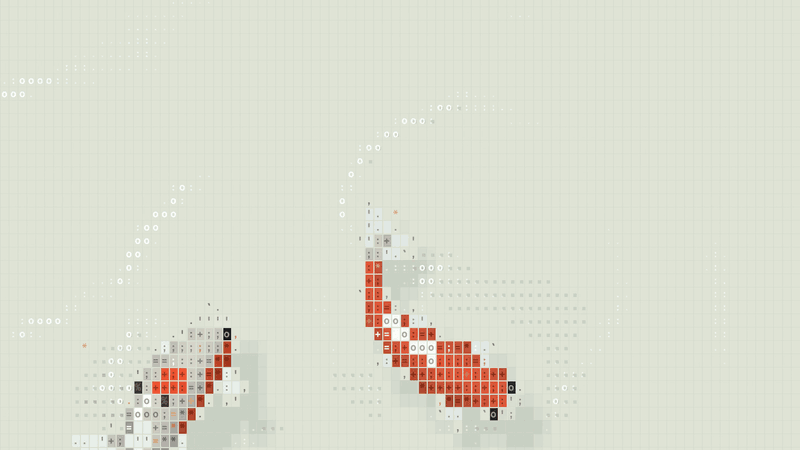

# ascii sharks



Living creatures drawn as ASCII on a canvas, every frame computed: no sprites, no prebaked art. Zero runtime dependencies.

Five scenes share one engine:

- **koi**: a pond with rain and ripples. Click to scatter food. By day, sunlight nets the floor with caustics.
- **ocean**: sharks hunting schools of small fish.
- **whales**: humpbacks blowing a bubble net round a krill swarm, then lunging up through it.
- **dragon**: a white dragon threading in and out of a sea of cloud. Click to part the clouds.
- **butterflies**: a sunlit meadow with clustered flowers, layered flight, sinusoidal wingbeats and occasional flower visits. Click to scatter nearby butterflies.

```sh
pnpm install && pnpm dev
```

Keys `1`–`5` switch scenes. `W` toggles the wind, `L` toggles day and night in the koi pond, and `S` toggles its tree shade. The same settings work as URL parameters: `?scene=butterflies`, `?theme=light`, `?wind=off`, `?shade=on`.

```ts
import { DRAGON, OceanEngine } from "./src";

const engine = new OceanEngine(canvas, DRAGON);
```

How it works, and why it is built this way: [docs/PRINCIPLES.md](docs/PRINCIPLES.md) (in Chinese).

Forked from [stackedlol/ascii-sharks](https://github.com/stackedlol/ascii-sharks).
